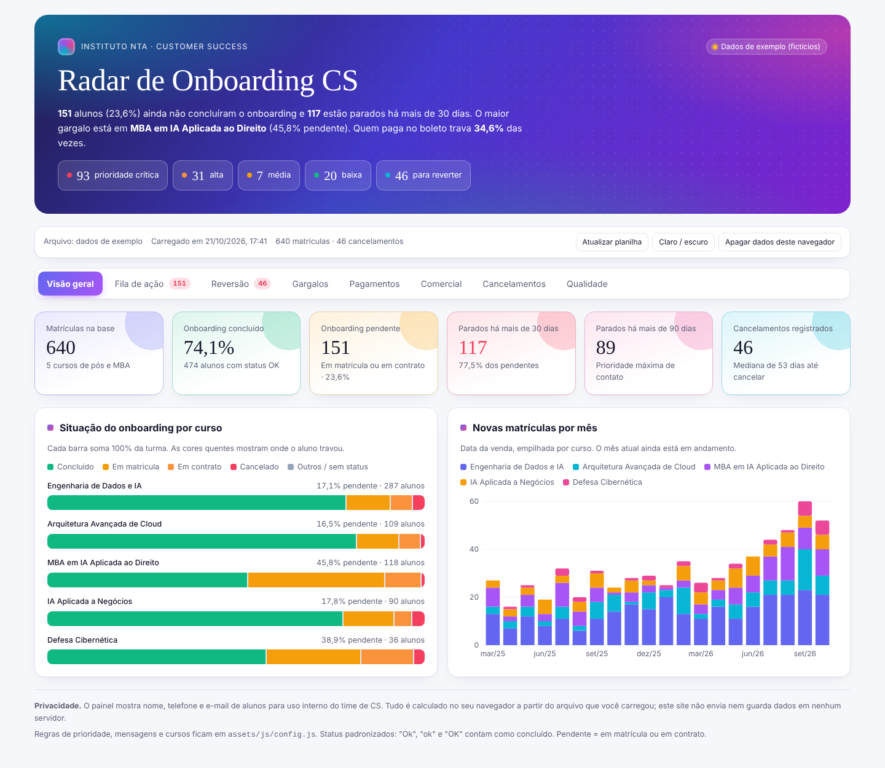
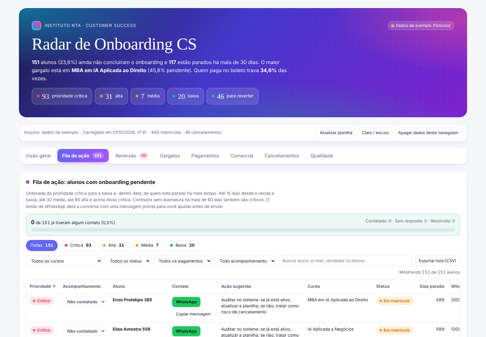
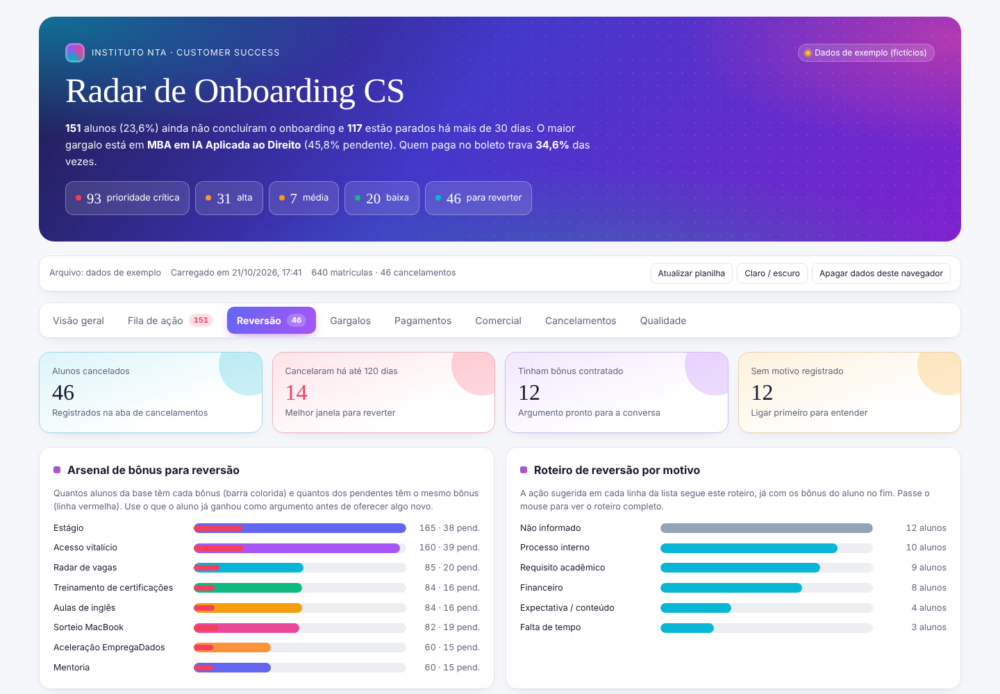
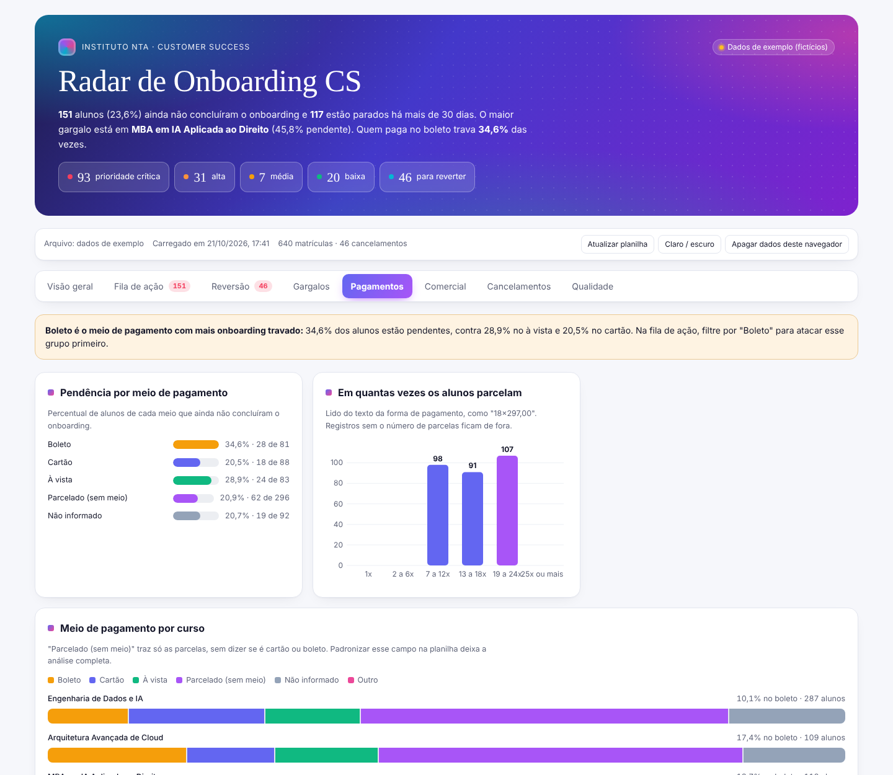
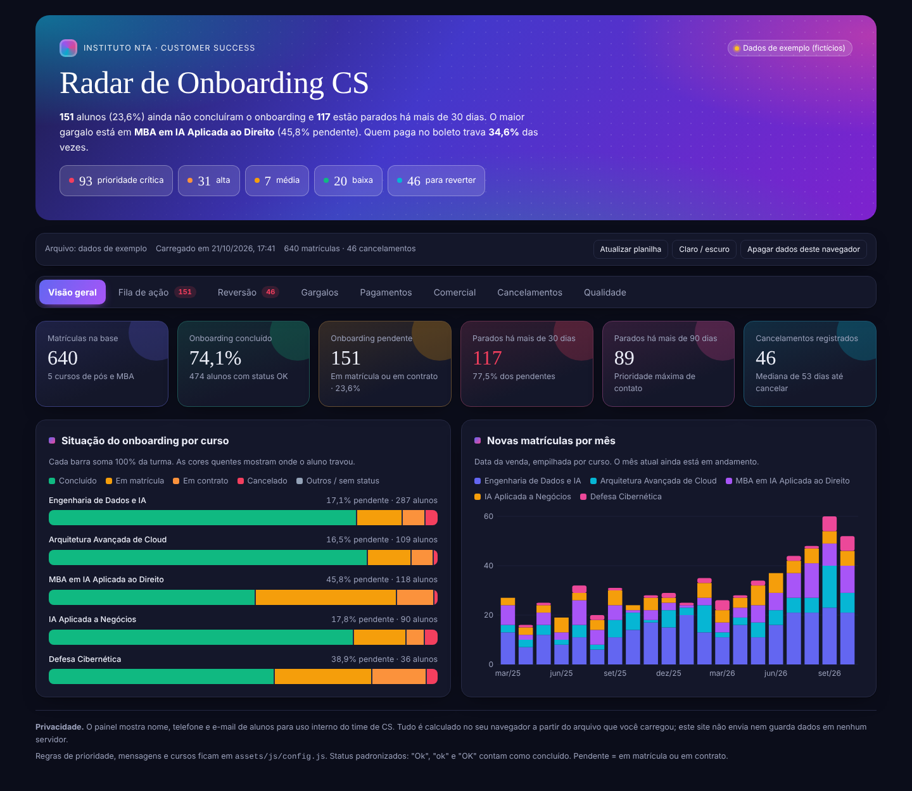

# Radar de Onboarding CS

Painel de acompanhamento de matrículas da Pós-graduação e dos MBAs do **Instituto NTA**. Ele mostra quem está travado no onboarding, há quanto tempo, qual curso concentra os gargalos e qual é a próxima ação para cada aluno.

> **Este repositório não guarda nenhum dado de aluno.** A planilha é lida no seu próprio navegador e nunca sai do seu computador.

**[Abrir o painel](https://institutonta.github.io/radar-onboarding-cs/)** · **[Ver com dados de exemplo](https://institutonta.github.io/radar-onboarding-cs/?demo=1)**



---

## O que o painel entrega

| Aba | Para que serve |
|---|---|
| **Visão geral** | KPIs do onboarding, situação por curso e evolução das vendas mês a mês |
| **Fila de ação** | Alunos pendentes ordenados por prioridade (Crítica, Alta, Média, Baixa), com WhatsApp em um clique, mensagem pronta e marcação de "contatado / resolvido" |
| **Reversão** | Cancelados com janela de reversão, motivo agrupado e os bônus que podem ser oferecidos na conversa |
| **Gargalos** | Tempo parado por etapa (Em matrícula, Em contrato) e cursos com maior taxa de pendência |
| **Pagamentos** | Taxa de pendência por forma de pagamento (Boleto, Cartão, À vista, parcelado) |
| **Comercial** | Volume e pendência por vendedor, como apoio, e não como ranking |
| **Cancelamentos** | Motivos, tempo até o cancelamento e cursos mais afetados |
| **Qualidade** | Campos vazios ou fora do padrão na planilha, para corrigir na origem |

<table>
<tr>
<td></td>
<td></td>
</tr>
<tr>
<td></td>
<td></td>
</tr>
</table>

---

## Como usar (3 passos)

1. **Baixe uma cópia** da planilha `Matriculas_Pós.xlsx`. Use sempre uma cópia, nunca o arquivo original do time comercial.
2. **Abra o painel** pelo link acima.
3. **Arraste o arquivo** para a área indicada ou clique em *Escolher planilha*. Pronto: o painel monta tudo em poucos segundos.

Na próxima vez em que você abrir o painel no mesmo navegador, os dados da última carga continuam lá. Para atualizar, basta carregar uma cópia mais recente.

### Marcação de acompanhamento

Na **Fila de ação** e na **Reversão**, cada aluno tem a opção *Contatado* e *Resolvido*. Essa marcação fica salva no seu navegador.

- Para **levar para outro computador** ou **passar para um colega**, use *Exportar acompanhamento* (gera um arquivo `.json`) e, do outro lado, *Importar acompanhamento*.
- Para levar uma lista para o Excel, use *Exportar lista (CSV)*.

---

## Privacidade: por que é seguro

- O site é **100% estático**. Não há servidor, banco de dados nem envio de arquivos.
- A leitura da planilha acontece **dentro do navegador** de quem está usando.
- O que fica salvo (última carga, tema e marcações) vai para o armazenamento local do navegador. Para apagar, clique em **Apagar dados deste navegador**.
- As imagens deste README e o modo `?demo=1` usam **pessoas inventadas** (`@exemplo.com`).
- O painel exibe o motivo do cancelamento **apenas agrupado em categorias**, nunca o texto livre, que pode conter informações pessoais.

**Regra de ouro:** nunca faça commit de planilhas, CSVs ou exportações com dados de alunos neste repositório. O arquivo `.gitignore` já bloqueia arquivos `.xlsx`, `.csv` e `.json`.

---

## Regras de negócio

| Regra | Como é calculada |
|---|---|
| **Pendente** | Status `Em matrícula` ou `Em contrato` |
| **Prioridade, Em matrícula** | até 15 dias: Baixa · até 30: Média · até 90: Alta · acima de 90: Crítica |
| **Prioridade, Em contrato** | até 15 dias: Baixa · até 60: Alta · acima de 60: Crítica |
| **Exceção** | Observação citando colação de grau: Média, porque depende do aluno |
| **Janela de reversão** | até 120 dias: Recente · até 240: Intermediária · acima disso: Antiga |

Todas essas faixas podem ser ajustadas sem mexer no restante do código (veja abaixo).

---

## Como ajustar (sem programar)

Tudo o que muda com frequência fica em um único arquivo: [`assets/js/config.js`](assets/js/config.js).

- **Curso novo:** adicione uma linha em `cursos`, com o nome exato da aba na planilha (`aba`), o nome que aparece no painel (`nome`) e uma cor.
- **Coluna renomeada:** inclua o novo nome na lista de `colunas` correspondente. O painel aceita vários nomes para a mesma coluna.
- **Faixas de prioridade:** altere os números em `prioridade`.
- **Mensagens de WhatsApp:** edite os textos em `mensagens`. `{nome}` e `{curso}` são substituídos automaticamente.
- **Bônus e motivos:** ajuste as palavras-chave em `bonus` e `motivos`.

Pelo próprio GitHub: abra o arquivo, clique no lápis (*Edit*), faça a alteração e clique em *Commit changes*. Em cerca de 1 minuto o site já estará atualizado.

---

## Estrutura

```
index.html              página do painel
assets/
  css/app.css           visual (tema claro e escuro)
  js/config.js          ← regras e textos ajustáveis
  js/dados.js           leitura da planilha e cálculos
  js/app.js             telas, gráficos e interações
  js/demo.js            gerador de dados fictícios
  vendor/               bibliotecas (D3 e SheetJS) incluídas no repositório
docs/img/               capturas de tela com dados de exemplo
```

Para testar localmente, rode na pasta do projeto `python3 -m http.server` e abra `http://localhost:8000`.

---

Feito pelo time de **CS Pós-venda · Instituto NTA**.
